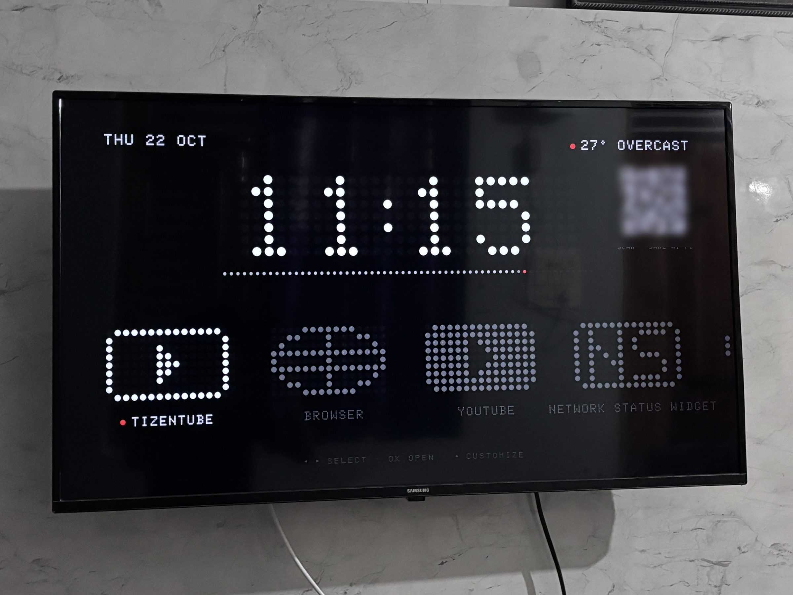
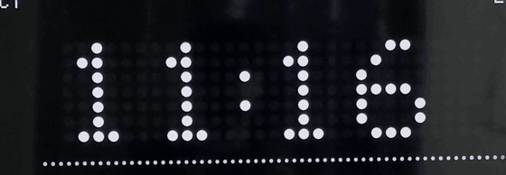
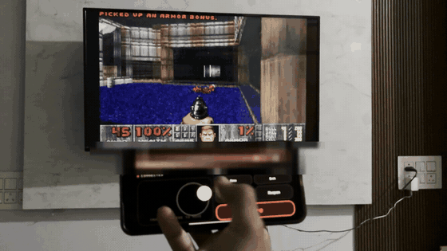
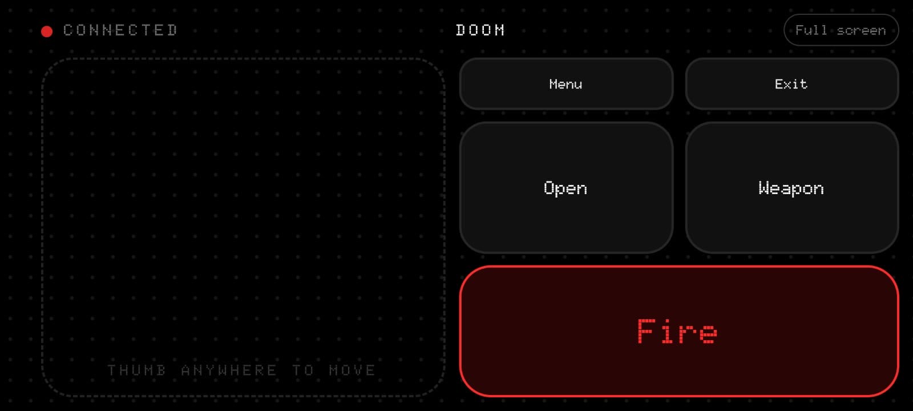
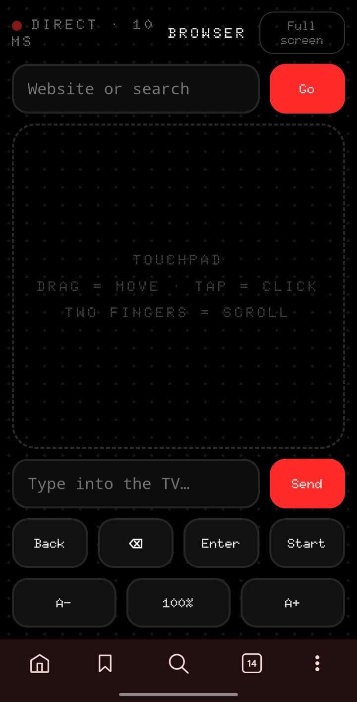
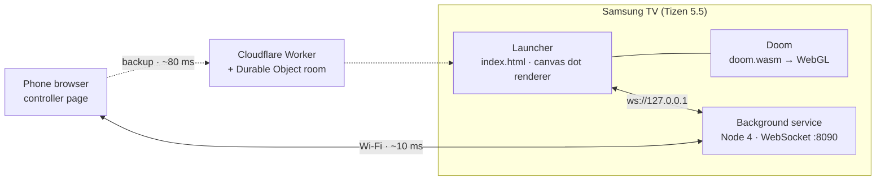

<div align="center">

# DotOS for Samsung TVs

**A custom dot-matrix home screen, Doom at 34 fps, Snake and a phone remote for a 2020 Samsung Smart TV.**<br>
Installed over Wi-Fi from a laptop. No root, no modified firmware.




</div>

> Built by **[prutxvi](https://github.com/prutxvi)** with **Claude** (Anthropic's AI). I set the direction and made the calls; Claude did the network scanning, the reverse engineering, the code and the debugging.

## Contents
- [Features](#features)
- [Results](#results)
- [How it works](#how-it-works)
- [Quick start](#quick-start)
- [Repository layout](#repository-layout)
- [Compatibility and limits](#compatibility-and-limits)
- [Security](#security)
- [Credits and licences](#credits-and-licences)

## Features

<table>
<tr>
<td width="50%"></td>
<td width="50%"></td>
</tr>
<tr>
<td align="center"><sub>The dot clock ripples when the minute changes</sub></td>
<td align="center"><sub>Doom on the TV, phone as the gamepad</sub></td>
</tr>
</table>

| | What you get |
|---|---|
| **Launcher** | A home screen in the style of Nothing OS: a rippling dot clock, a 60-dot seconds bar, weather, and a dock of dot icons. Put **any installed app** in the dock; apps without an icon get one generated from their initials. Accent colour, clock format and size, layout and more are all set from the remote (press ▲). |
| **Doom** | The 1993 shareware Doom compiled to WebAssembly and drawn through WebGL, running **on the TV's own chip at 34 fps** (Doom's cap is 35). Optional LED "dot" look, toggled with Blue. |
| **Snake** | Dot-matrix Snake on a 48×26 grid. Speeds up as you eat; best score is saved. |
| **Phone remote** | Scan the QR on the TV and your phone becomes the controller, no app needed. The layout follows the screen: D-pad, swipe pad, or a floating joystick plus FIRE for Doom. **~10 ms** over Wi-Fi via a server running on the TV, with an optional Cloudflare relay as backup. |
| **TV Browser+** | A companion [TizenBrew module](https://github.com/prutxvi/tv-browser-plus): a remote cursor, link-jump mode, per-site zoom and a phone touchpad for any website. |

<p align="center">
  
  &nbsp;
  
</p>

## Results

All numbers measured on the TV itself (Samsung UA43T5310, 2020).

| | Before | After | What changed |
|---|---:|---:|---|
| Doom frame rate | 18 fps | **34 fps** | Rebuilt the engine (below) |
| Doom time per frame | 53 ms | **4.4 ms** | Profiling showed 90% of the time in one pixel-copy function |
| Phone → TV latency | ~80 ms | **~10 ms** | A WebSocket server on the TV instead of a cloud relay |

**The Doom rebuild:** native 320×200 instead of 640×400 (the GPU scales it up), a 256-entry palette lookup writing 32-bit pixels instead of 16 byte-writes per pixel, and `-O3` instead of `-Os`. Details in [`doom-build/`](doom-build/README.txt).

## How it works



- **Apps are web apps.** Tizen apps are HTML/JS packaged as a signed `.wgt`; Developer Mode lets a trusted laptop install them over Wi-Fi.
- **Doom is native.** The engine runs as WebAssembly inside the TV's Chromium 94 engine. Frames go to the GPU as a WebGL texture, because `putImageData` on large canvases silently draws nothing on this TV.
- **The phone server is hand-written** for the TV's Node.js v4.4.3 (2016, no npm): the WebSocket handshake and framing in ~135 lines.

More in [docs/ARCHITECTURE.md](docs/ARCHITECTURE.md). Every trap we hit is in [docs/LESSONS.md](docs/LESSONS.md); read it before building anything for a Tizen TV.

## Quick start

You need a Samsung TV on Tizen 3–6 (roughly 2017–2021 models), a computer on the same Wi-Fi, and Samsung's Tizen Studio CLI. First run takes about 30 minutes.

```bash
# 1. TV: Apps → press 1 2 3 4 5 → Developer mode On, Host PC IP = your computer → hold Power 5 s
# 2. Sign and install
sdb connect <tv-ip>
tizen package -t wgt -s <your-profile> -o out -- launcher
tizen install -n Home.wgt -- out -s <tv-ip>:26101
tizen run -p PvHomeLnch.Home -s <tv-ip>:26101
```

Full walkthrough, including creating a signing profile and the optional relay: **[docs/SETUP.md](docs/SETUP.md)**.

> [!TIP]
> Always kill the running app before reinstalling (`sdb shell 0 was_kill PvHomeLnch.Home`). Tizen otherwise resumes the old window and you'll think your new build is broken.

## Repository layout

```
launcher/            The TV app (package this folder)
  index.html         Launcher, Snake, Customize · dot-matrix renderer
  doom.html          Doom page: WebGL presenter, LED mode, controls
  doom.wasm          Rebuilt engine + shareware WAD (GPL-2.0, see NOTICE)
  remote.js          Joins the phone room (local + optional cloud)
  service/           Background service: WebSocket server + phone page
relay/               Optional Cloudflare Worker (Durable Object rooms, start page)
doom-build/          Patched doomgeneric files and exact build steps
docs/                SETUP · ARCHITECTURE · LESSONS · media
```

## Compatibility and limits

- **Tested on** Samsung UA43T5310 (2020, Tizen 5.5, Chromium 94, 4 cores, ~1 GB RAM). Other Tizen 3–6 TVs should work. **Tizen 7+** requires a Samsung certificate for signing.
- It **can't replace Samsung's Home bar** or start at boot; that's a platform restriction. Pin it as the first app instead.
- No root and no custom firmware. Nothing here modifies the TV's system.
- The phone controls the launcher, Snake, Doom and TV Browser+ pages, not other apps like YouTube or Netflix.

## Security

- The QR code is a **private room link**: whoever has it can control the launcher. Room IDs are 20 random characters (~103 bits). Don't post photos of your TV with the QR visible.
- The TV service only reveals the room ID to the TV itself (`127.0.0.1`); other devices on the Wi-Fi get a 403.
- Phones can only send an allow-listed set of message types, capped at 512 bytes on the TV.
- Your signing certificate and its password never belong in the repo; `.gitignore` excludes `*.p12` and signature files.

## Credits and licences

- **Our code** (launcher, phone remote, relay, docs): [MIT](LICENSE).
- **Doom engine:** [jacobenget/doom.wasm](https://github.com/jacobenget/doom.wasm), built on [doomgeneric](https://github.com/ozkl/doomgeneric). **GPL-2.0.** Our changes are in [`doom-build/`](doom-build/).
- **Doom shareware WAD** v1.9, freely distributable, © id Software.
- **QR codes:** [qrcode-generator](https://github.com/kazuhikoarase/qrcode-generator) by Kazuhiko Arase, MIT.
- **Fonts:** Doto and Space Mono, SIL OFL.
- **Inspiration and tooling:** [TizenBrew](https://github.com/reisxd/TizenBrew) by reisxd · Nothing OS.

Full third-party list: [NOTICE](NOTICE).
